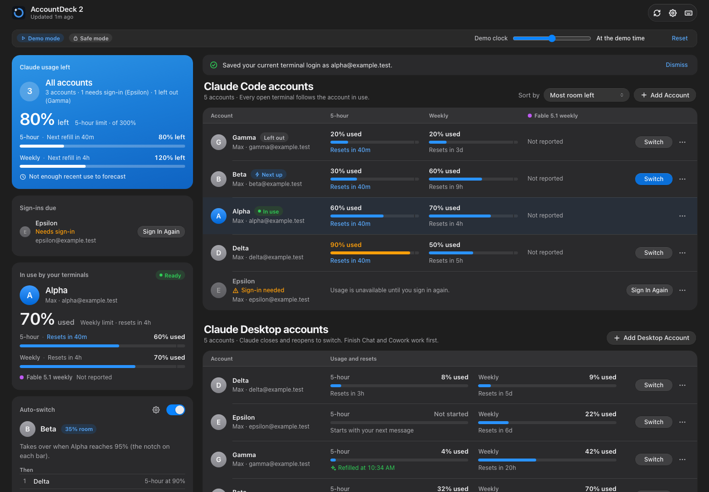
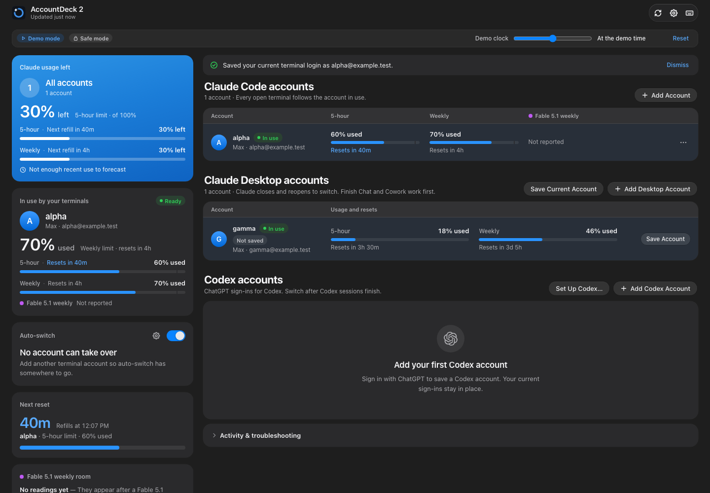

# AccountDeck

A Mac menu bar app that shows how much Claude, Codex and Antigravity usage each of your accounts has left
and switches Claude Code, Claude Desktop, Codex and Antigravity's `agy` between your own saved accounts.

[](https://github.com/boha-k/accountdeck/actions/workflows/check.yml)
[](LICENSE)
[](#requirements)
[](https://github.com/boha-k/accountdeck/releases/latest)



## What it does

AccountDeck runs a small service on your Mac and shows a dashboard and a menu bar item for four apps:

- **Claude Code in terminals.** It saves the login your terminals use by itself, and you add more
  accounts with a separate sign-in. A switch moves every open terminal and the VS Code extension to
  another account on their next message; nothing is closed, and MCP logins, plugins, settings and
  history stay shared.
- **Usage and resets.** The 5-hour, weekly and per-model weekly limits of every account, a countdown to
  each reset, the total left across your accounts and a forecast of when they run dry. Missing usage is
  never shown as zero.
- **Limit resets.** How many limit resets (OpenAI: banked resets) each Claude and Codex account holds, what
  each refills and when it expires, and **Use a Limit Reset…** for one account after you confirm what will
  happen. Never automatic unless you turn on **Use a limit reset when every terminal account is out** (off by
  default): AccountDeck then uses one Claude Code reset, on one account at a time, once every terminal account
  is at 97 % or more, and tells you each time.
- **Auto-switch.** When the account in use reaches 95 % of a limit (you can change that), the terminals
  move to the next account with room. When a session hits a limit anyway, they move within seconds.
  Undo is available for 10 minutes.
- **Codex.** Saves your ChatGPT sign-ins for Codex, shows their usage, and switches Codex once its
  sessions have finished.
- **Claude Desktop.** Saves the accounts you sign in to in Claude Desktop and shows their usage. To switch,
  it quits Claude, puts the other account's sign-in in place, reopens Claude and checks which account came
  back.
- **Antigravity.** Saves the personal Google sign-ins of Antigravity's command-line tool `agy` (not the
  Antigravity app or IDE), reads the limits of the account it is signed in to when you click Refresh Usage
  or open AccountDeck, and switches `agy` once no `agy` runs. It never switches Antigravity by itself; read
  [Google's terms](docs/GUIDE.md#googles-terms) first.
- **Alerts and the menu bar.** macOS notifications for low limits, refills, switches and logins about to
  end, with quiet hours. The menu bar item shows the room left at a glance.
- **Updates.** Every 5 minutes, and when you open it, it asks GitHub whether a newer release is out. When
  one is, the dashboard and the menu bar offer it, and you choose when to install it.

It is for people who use several Claude (Pro, Max, Ultra), ChatGPT or Google accounts of their own on one
Mac, mostly with Claude Code in the terminal, and want to see what each has left and move between them
without signing in and out. With one account you do not need it.

## Requirements

- A Mac with Apple silicon and macOS 14 (Sonoma) or newer. AccountDeck is developed and tested on
  macOS 27 only; macOS 14 to 26 are supported but not tested. Intel Macs are not supported.
- An internet connection for the install (about 30 MB).
- The apps you want it to manage, each signed in once: Claude Code, Claude Desktop, the Codex CLI or
  ChatGPT.app, Antigravity's `agy`.

Nothing else: no Homebrew, no Python, no developer tools (except `git` for the third way to install).

## Install

In Terminal, as yourself (no `sudo`):

```sh
curl -fsSL https://github.com/boha-k/accountdeck/releases/latest/download/get.sh | bash
```

`get.sh` comes from the latest release, so you only ever run released code. It downloads that release's
package from GitHub, checks its SHA-256, unpacks it into a temporary folder and runs its `install.sh`.
Options go after `bash -s --`, for example:

```sh
curl -fsSL https://github.com/boha-k/accountdeck/releases/latest/download/get.sh | bash -s -- --start-at-login
```

To read the script before it runs:

```sh
curl -fsSL https://github.com/boha-k/accountdeck/releases/latest/download/get.sh -o get.sh
less get.sh
bash get.sh
```

Or download the release package yourself:

```sh
cd "$(mktemp -d)"
curl -fLO https://github.com/boha-k/accountdeck/releases/latest/download/AccountDeck2-mac.tar.gz
curl -fLO https://github.com/boha-k/accountdeck/releases/latest/download/AccountDeck2-mac.tar.gz.sha256
shasum -a 256 -c AccountDeck2-mac.tar.gz.sha256
tar -xzf AccountDeck2-mac.tar.gz
bash AccountDeck2-mac/install.sh
```

Or install from a git checkout (the installer then runs the test suite against the code first):

```sh
git clone https://github.com/boha-k/accountdeck.git
cd accountdeck
bash install.sh
```

`install.sh` takes `--start-at-login` (open AccountDeck when you log in), `--no-launch` (do not open it
at the end), `--dry-run` (say what it would do and change nothing) and `--help`.

What the installer does to your Mac:

- It runs as you, never asks for an administrator password and refuses to run as root.
- It downloads Python 3.14 (a standalone build from the python-build-standalone project) and the `cffi`
  and `cryptography` packages, each pinned to one URL and checked against its SHA-256, into
  `~/Library/Application Support/AccountDeck2/runtime`. The packages go in with that Python's own pip.
  It does not use or change the system's Python or pip, Homebrew, your `PATH` or your shell profile.
- It puts AccountDeck's code in `~/Library/Application Support/AccountDeck2/app`. Your data lives beside
  it in the same folder, which only your user can read.
- It creates `~/Applications/AccountDeck 2.app`. The app's `python3` is a copy of that Python, signed ad
  hoc with the app's identity (`local.accountdeck2`), because macOS lets only a matching app send
  notifications.
- Only with `--start-at-login` (or once you turn on Open at login) does it add
  `~/Library/LaunchAgents/local.accountdeck2.plist`.
- At the end it opens AccountDeck 2.

## First run



**Opening it.** The installer opens AccountDeck 2; later, open it from your Applications folder or with
Spotlight. It has no Dock icon: a ring appears in the menu bar, and the dashboard opens in its own
window. Closing the window leaves AccountDeck running; **Open Dashboard** in the menu bar item brings it
back.

**What macOS asks.**

- *"AccountDeck 2" would like to send you notifications.* Choose **Allow** to get alerts about low
  limits, refills, switches and sign-ins due. You can change it later in System Settings ›
  Notifications.
- *security wants to use your confidential information stored in "Claude Code-credentials" (or "Claude
  Safe Storage") in your keychain.* This can appear when AccountDeck first reads Claude Code's login or
  Claude Desktop's key. Choose **Allow**. **Always Allow** is not needed, and it would let any program
  that uses Apple's `security` tool read that item without asking. AccountDeck's own key is created
  without a prompt.
- If you turn on **Open at login** (in **Settings → Menu Bar & Login**, or **Start at Login** in the
  menu bar menu), macOS lists AccountDeck 2 in System Settings › General › Login Items, where you can also
  switch it off.

**Claude Code in terminals.** Sign in to Claude Code once as usual. AccountDeck saves that login by itself
and says "Saved your current terminal login as …". To add another account, choose **Add Account** in
**Claude Code accounts**, then **Open Terminal**: sign in there with the other account and close that
window to finish. If the browser signs in with the wrong account, use a private window. Add as many
accounts as you use; auto-switch needs at least two.

**Codex.** Sign in to Codex once. In **Codex accounts**, **Save Current Account** saves the account Codex
uses. **Add Codex Account** starts Codex's own sign-in in a separate folder: choose **Open Sign-In Page**,
sign in with the other ChatGPT account, then **Save Sign-In**. Your current sign-in stays in place. Codex
must keep its sign-in in `~/.codex/auth.json`, which is its default
([details](docs/TROUBLESHOOTING.md#codex-codex-keeps-its-sign-in-in-the-macos-keychain)).

**Claude Desktop.** Sign in to Claude Desktop once. In **Claude Desktop accounts**, **Save Current
Account** saves the account Claude is signed in to. **Add Desktop Account** saves that one too, signs
Claude out and reopens it on its sign-in screen: sign in there with the other account, then choose
**Save Account**. Each of these closes and reopens Claude, so AccountDeck first shows what will happen
and waits for your go-ahead; finish Chat and Cowork work first. With Claude Desktop closed and no account
to show, the section stays a single line.

**Antigravity.** Sign in to `agy` once. In **Antigravity accounts**, **Save Current Account** saves the
account `agy` uses. **Add Antigravity Account** opens `agy` in a Terminal window, where you sign in with
another Google account; close every `agy` session first, since a running one would be signed out. Before
the first of these, AccountDeck shows a note about Google's terms for Antigravity once
([what it says](docs/GUIDE.md#googles-terms)).

**One rule.** Change accounts in AccountDeck, never with `/login` or `/logout` in Claude Code or an app's
own **Log out**: logging out can end a saved sign-in on the provider's side.

The [guide](docs/GUIDE.md) explains switching, auto-switch, Antigravity, alerts and everything else the
dashboard shows.

## Updating

When a new release is out, the dashboard says "AccountDeck X is available. You have Y." with **Update…**,
**What's New** and **Skip This Version**; the menu bar menu shows **Update to X…**, and one notification
says so. **Update…** first says what will happen, then runs the installed updater in a Terminal window,
where you can follow it. You can also run the updater yourself, or the install command again:

```sh
bash "$HOME/Library/Application Support/AccountDeck2/app/get.sh"
```

If you installed from a git checkout, you can also `git pull` there and run `bash install.sh` again. Your
saved accounts, settings and history are kept, and your Claude Code, Claude Desktop, Codex and `agy`
sessions are not touched; only AccountDeck itself restarts.

The installer refuses to update in the middle of a switch and refuses a downgrade. It checks the new
code, counts your saved accounts and copies your saved sign-ins to `update-backups/`. Then it starts the
new version, checks it for up to 60 seconds and counts again. If the new version is not healthy or an
account is missing, it puts the previous version back.

An installed copy checks every 5 minutes and when you open its menu or its dashboard, so it hears of a new
release within minutes. Each check is one small request that sends nothing about you
(see [below](#how-it-keeps-your-sign-ins-safe)); after checks that fail it waits longer, up to an hour. This
holds for a copy installed from a git checkout too; only `run.py` started straight from a checkout never asks.
**Check for updates automatically** in **Settings → About** turns it off; **Check Now** there asks at once,
and `get.sh --check` asks from Terminal.
[docs/UPGRADING.md](docs/UPGRADING.md) has the details.

## Uninstall

```sh
bash "$HOME/Library/Application Support/AccountDeck2/app/uninstall.sh"
```

It removes the app, the Python runtime, AccountDeck's code with its older copies and the Open at login
LaunchAgent. It keeps your saved accounts, settings, history and update snapshots in
`~/Library/Application Support/AccountDeck2`, so installing again brings them back.

`--delete-data` also deletes that folder and AccountDeck's logs after you type `delete`. Saved sign-ins
that are not signed in anywhere else cannot be recovered afterwards. The vault key stays in your login
keychain as `AccountDeck2 vault`; it opens nothing without the data, and Keychain Access can delete it.

## How it keeps your sign-ins safe

- **An encrypted vault.** Every saved sign-in is a file in `vault/`, encrypted with AES-256-GCM under a
  random 256-bit key. The key lives in your login keychain as `AccountDeck2 vault`, and AccountDeck
  reaches the Keychain only through Apple's `/usr/bin/security`, with values passed on its input rather
  than its command line. The one exception: a Claude Code login too long for one input line (it grows
  with stored MCP sign-ins) is passed on the command line as hex, as Claude Code's own writes of that item
  do, so another user of the same Mac could see it for that moment. Without the key no record opens: a
  missing key fails closed, and AccountDeck never makes a new key over old records.
- **Your folder only.** The data folder can be read only by your macOS user.
- **Recoverable changes.** Before a switch changes an app's sign-in, AccountDeck writes an encrypted
  record of what was there. A failed switch is put back without undoing anything the app changed
  afterwards. Reading usage never renews a token an app is using; Antigravity's usage is read by `agy`
  itself, which may renew its own sign-in as it does whenever it runs.
- **A local service.** The service listens on `127.0.0.1` only, so other machines cannot reach it. The
  dashboard gets a random token, made new each time AccountDeck starts, and exchanges it for a session
  cookie; every change must come from the dashboard's own page; a strict content policy stops it loading
  anything from elsewhere. The dashboard uses no CDN and no web fonts.
- **Only the providers.** AccountDeck connects to Anthropic's `api.anthropic.com` (usage, account, an
  account's limit resets, and the one request that uses a limit reset when you confirm it, or when you
  turned on the automatic use and every terminal account is out),
  `platform.claude.com` (renewing a saved Claude login) and `claude.ai` (Claude Desktop's usage when its
  token cannot be used), to the status pages `status.claude.com` and `status.openai.com`, and, before it
  renews a saved Codex login, opens a connection to `auth.openai.com` to see whether the Mac is online.
  Codex usage is read, and a Codex limit reset used, by your installed Codex CLI, which talks to OpenAI
  itself, and Antigravity usage by your installed `agy`, which talks to Google itself; AccountDeck sends
  nothing to Google. The installer and `get.sh` download from GitHub and the Python Package Index.
- **A small update check.** Every 5 minutes, and when you open the menu or the dashboard (at most once a
  minute), an installed copy sends one request to `github.com/boha-k/accountdeck/releases/latest`. It asks
  only for the headers (a HEAD request), has no body in either direction and carries nothing but the user
  agent `AccountDeck2/<version> (+local)`: no account, no identifier, no cookie. GitHub answers with a
  redirect to the latest release, and only the version number in it is kept. After checks that fail it waits
  longer, up to an hour (or as long as GitHub asks, up to 6 hours). If GitHub's answer ever cannot be read,
  AccountDeck asks `api.github.com/repos/boha-k/accountdeck/releases/latest` instead, at most once a day,
  with the same user agent and nothing else about you. GitHub sees your IP address, as with any request. No
  text from GitHub is shown. With **Check for updates automatically** off, no request is made. `run.py`
  started straight from a git checkout, the demo and safe mode never make it.
- **Nothing else leaves the Mac.** No telemetry, no analytics and no crash reports. AccountDeck's own log
  never contains tokens, cookies, keys or email addresses. `logs/agy-usage.log`, which `agy` writes during
  a usage read, can name your email address; only you can read it.

## Limits and disclaimer

- AccountDeck is an unofficial tool. It is not affiliated with, endorsed by or supported by Anthropic,
  OpenAI or Google. Claude, Claude Code and Claude Desktop are Anthropic's products, Codex and ChatGPT are
  OpenAI's, Antigravity is Google's; their names and logos are used only to say what AccountDeck works with
  and which app an account belongs to. The logos are trademarks of Anthropic and OpenAI (see
  [THIRD_PARTY_NOTICES.md](THIRD_PARTY_NOTICES.md)); Antigravity's accounts are marked with a glyph of
  AccountDeck's own, not Google's logo.
- It relies on how Claude Code, Claude Desktop, Codex and `agy` store their sign-ins and report usage. None
  of that is a documented interface, and an update to any of those apps can stop AccountDeck reading or
  switching until AccountDeck is updated. Its health report checks Claude Code's formats and alerts when
  they no longer match.
- Use it only with accounts that are yours, and within each provider's terms. Google's terms for
  Antigravity do not allow third-party tools to access it; the [guide](docs/GUIDE.md#googles-terms) says
  what AccountDeck does and does not do, so you can decide. Anthropic documents its limit reset button on
  claude.ai only; AccountDeck reads your resets and [uses one](docs/GUIDE.md#using-one) with your sign-in
  under Claude Code's name, because Anthropic lists them to no other app. Every other request names AccountDeck. It shows and switches accounts; it adds no capacity.
- It comes with no warranty (see [LICENSE](LICENSE)). Keep a way to sign in to each account without
  AccountDeck.

## Troubleshooting

Run the health report; it checks everything AccountDeck depends on and says what to do:

```sh
"$HOME/Library/Application Support/AccountDeck2/runtime/python/bin/python3.14" -E -s \
  "$HOME/Library/Application Support/AccountDeck2/app/run.py" --doctor
```

The log is `~/Library/Application Support/AccountDeck2/logs/accountdeck2.log`. Keychain prompts,
notifications, Codex settings, Antigravity, the update prompt and failed updates are in
[docs/TROUBLESHOOTING.md](docs/TROUBLESHOOTING.md).

## More

- [Guide](docs/GUIDE.md): how AccountDeck behaves, in detail
- [Updating](docs/UPGRADING.md) and [Troubleshooting](docs/TROUBLESHOOTING.md)
- [Architecture](docs/ARCHITECTURE.md) and [all documentation](docs/README.md)
- [Contributing](CONTRIBUTING.md) and [Security policy](SECURITY.md)
- [Changelog](CHANGELOG.md), [License](LICENSE) (MIT) and [Third-party notices](THIRD_PARTY_NOTICES.md)
