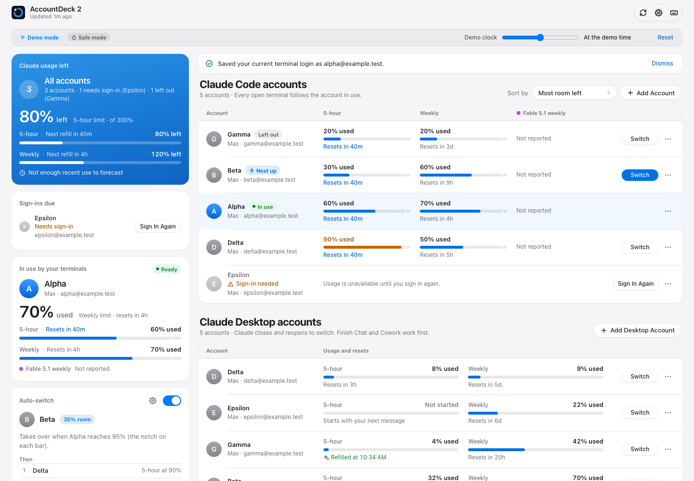
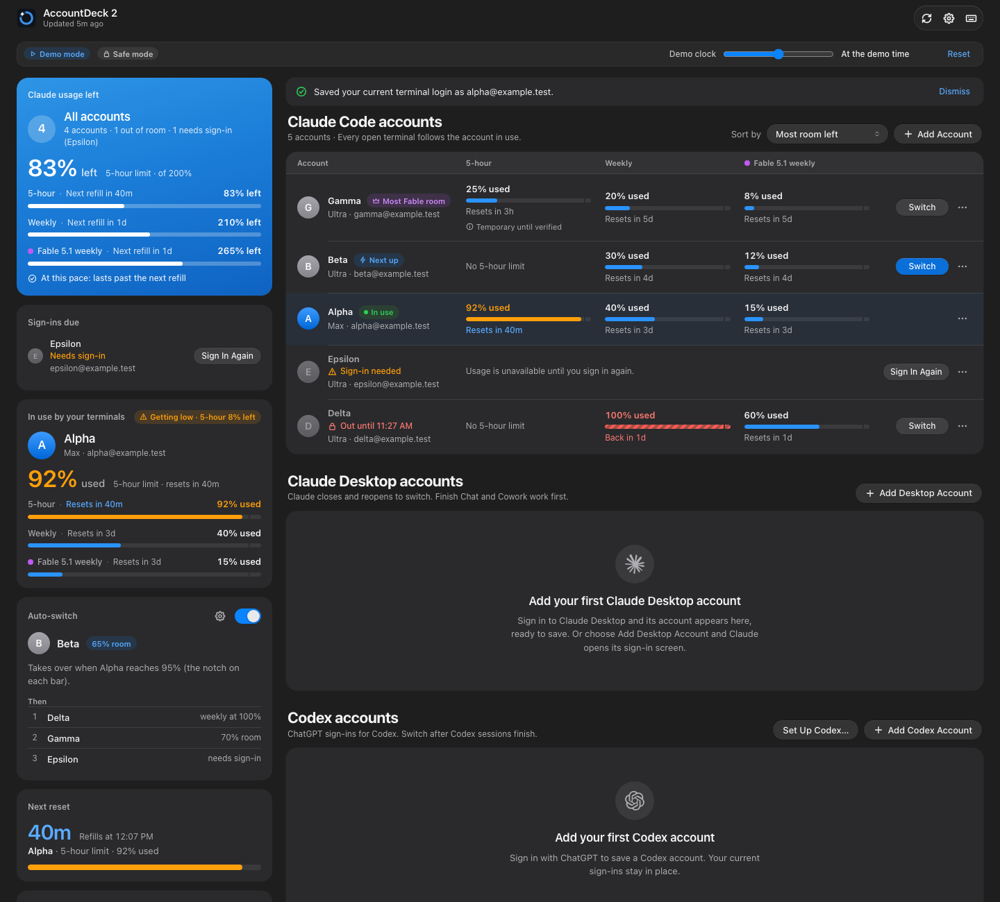
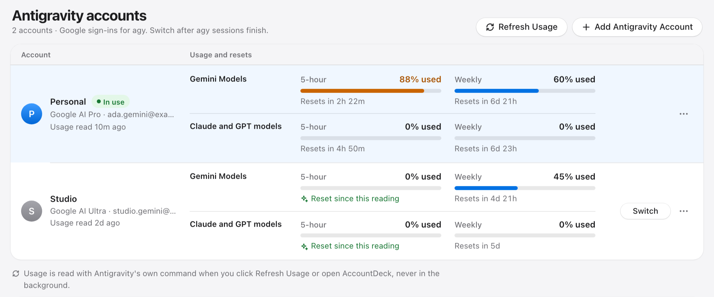

# AccountDeck guide

How AccountDeck behaves once it is installed: what the menu bar item and the dashboard do, how switching
works for Claude Code in terminals, Claude Desktop, Codex and Antigravity, how auto-switch works for the
terminals, what the alerts mean and how AccountDeck looks after itself. For installing, the first run and
updating, see the [README](../README.md); for problems, [TROUBLESHOOTING.md](TROUBLESHOOTING.md).

AccountDeck manages four apps: **Claude Code** in terminals (the `Claude Code-credentials` Keychain
login), **Claude Desktop**, **Codex** (`~/.codex/auth.json`) and **Antigravity**'s command-line tool
`agy` (its `gemini` Keychain item). A small Python service serves the dashboard on 127.0.0.1 and keeps
every saved sign-in in an encrypted vault whose key lives in your login keychain.

## Contents

- [The app and the menu bar](#the-app-and-the-menu-bar)
- [Claude Code in terminals](#claude-code-in-terminals)
  - [Adding and switching accounts](#adding-and-switching-accounts)
  - [Plans and limits](#plans-and-limits)
  - [Auto-switch](#auto-switch)
  - [Limit errors](#limit-errors)
  - [Logins that end](#logins-that-end)
  - [Things AccountDeck never does](#things-accountdeck-never-does)
- [Claude Desktop and Codex](#claude-desktop-and-codex)
  - [Claude Desktop](#claude-desktop)
  - [Codex](#codex)
  - [Interrupted switches and Recover](#interrupted-switches-and-recover)
- [Antigravity](#antigravity)
  - [What AccountDeck manages](#what-accountdeck-manages)
  - [Antigravity usage](#antigravity-usage)
  - [Saving, adding and switching](#saving-adding-and-switching)
  - [No automatic switching](#no-automatic-switching)
  - [Google's terms](#googles-terms)
- [Usage and alerts](#usage-and-alerts)
- [Limit resets](#limit-resets)
  - [What you see](#what-you-see)
  - [Using one](#using-one)
  - [What AccountDeck never does with them](#what-accountdeck-never-does-with-them)
- [Reliability](#reliability)
- [Updates](#updates)
- [Command line](#command-line)
- [Accounts from the PC (optional)](#accounts-from-the-pc-optional)

## The app and the menu bar

Open **AccountDeck 2** from your Applications folder or with Spotlight. It has no Dock icon: the menu bar item
is the app. Opening it again while it runs reaches the running copy and shows its dashboard.

The menu bar item is a ring whose arc is the room left on the account your terminals use, with a dot when
a reset is minutes away. It is drawn in the menu bar's own colour while all is well and turns amber or red
only when the account needs attention. Beside it, the terminal room left in accounts' worth, for example
`5h 4.2 · wk 5.6` (only `wk` while no account has a 5-hour limit). Its menu shows the account in use, the
next reset, the best account and the totals (and, once `agy` is installed or an Antigravity account is
saved, the account `agy` uses with its tightest limit), then **Open Dashboard** (⌘O, in the app's own
window; hold ⌥ to open it in the browser), one **Switch … To** submenu per app (**Switch Claude To** for
Claude Desktop, **Switch Codex To**, **Switch Claude Code (terminal) To**, **Switch Antigravity To**),
**Refresh Now** (⌘R), **Turn On
Notifications…** when macOS has them off, **Start at Login**, **Update to X…** while a newer release is
offered, **Check for Updates…** (only in an installed copy, which is the one that checks) and **Quit
AccountDeck 2** (⌘Q). A switch or an update from the menu shows
what will happen and asks first, as the dashboard does.



Closing the dashboard window or the browser leaves the service running. **Open at login** is in
**Settings → Menu Bar & Login** (a per-user LaunchAgent, `local.accountdeck2`; **Start at Login** in the
menu bar menu is the same switch); macOS lists it in System Settings › General › Login Items, where it can
also be switched off.

## Claude Code in terminals

### Adding and switching accounts

The **Claude Code accounts** section saves your current terminal login by itself and mirrors later
token rotations into the vault. **Add Account** opens a separate terminal for the sign-in; the login is
saved only after that terminal closes (use a private browser window if the sign-in picks the wrong
account). Switches and auto-switch go on while that terminal is open: its sign-in has its own folder and
Keychain item. **Sign In Again** repairs an expired saved login the same way. For the account your
terminals are using, the new login reaches them within seconds, under a switch's transaction and
rollback, unless Claude Code holds a newer one; it waits while an interrupted terminal switch is settled.

A switch changes the default Claude Code login under Claude Code's own locks. Every open terminal and the
VS Code extension follow on their next message; nothing is closed. MCP logins, plugins, projects,
settings and history stay shared. Claude Desktop's Code tabs keep their Desktop login. A switch renews
its target's login first, so a login that no longer works fails the switch and asks for sign-in instead
of failing in your terminals. If Claude's sign-in service doesn't answer, AccountDeck stops renewing for
a while and switches only to logins that are still valid without renewing them. A renewal that could not
connect at all used nothing up: it never asks for sign-in, it only pauses renewals.

### Plans and limits

Accounts with and without a 5-hour limit sit side by side. Since 2026-10-30 verified **Ultra** accounts
(the former Max 20x) have only weekly limits: the general one and Fable's. Max, Pro and Ultra accounts
still on Anthropic's temporary limit also have a 5-hour limit. Plans read Ultra, Max or Pro from the
login's tier. Limits come from Claude's own list of meters, so a new meter holds and moves the terminals
without a release, unless it belongs to another app or to a model that is neither Fable nor pinned; codenames
Claude doesn't list are never shown or counted.



### Auto-switch

**Auto-switch** is on at **95 % used**, watching the 5-hour (where the account has one), the weekly and the
Fable weekly limits, and the weekly limit of a model you pinned (a name also matches its versions: "Fable" is
"Fable 5.1" too). Fable's limit always counts, whatever is pinned: an account that is out of Fable is left, and
is no target. Order: **Soonest reset first**, **Most
room left first** or **My own order**; the same accounts always give the same pick. A target needs a reading under 15
minutes old, 10 points of room below the threshold in every watched window, no limit locked by Claude and,
once known, a login lasting 12 more hours. Accounts whose reads are paused or failing, or whose automatic
switch failed for a reason about that account (retried after 10 minutes, doubling to an hour), wait. A
failure about this Mac (Keychain, disk, Claude Code's locks) keeps every account eligible, pauses
auto-switch for a minute, doubling to 15 minutes, and alerts at once; an ongoing failure alerts at most
hourly. While none qualifies, an account whose last read failed is read again (at most every 3 minutes)
rather than waiting for its next scheduled read.

A passed reset counts as refilled until the next reading. A limit filling fast switches early when its
burn rate would pass the threshold before the next check; the burn rate counts only readings since the
terminals came to that account and since the Mac last woke. When no account qualifies, every account is
used up to 99 %: the active one stays until 99 %, then terminals move to an account with at least 2
points left. An account that is out of a limit, needs sign-in or has under an hour of login left never
waits: terminals move to the account with the most room by its last reading (up to a day old and at most
97 % used), even one whose login ends within 12 hours if it has over 2 hours left. When the account in use
works for no model at all (its weekly or 5-hour limit is spent, it is on hold or its login is gone) and every
other account is out of a model's own limit only, the terminals move to the one whose week has the most
room: other models still work there. An account that is only out of Fable is never left for another one
that is out of Fable too; when that is all that is low, the alert says "All terminal accounts are low on
their Fable weekly limit; other models still have room." A 5-hour refill within
10 minutes and an expired idle terminal token hold only a threshold switch; a Claude outage holds nothing.

Another action in progress holds auto-switch until it finishes, except a Claude Desktop, Codex or
Antigravity switch still waiting for sessions to close: a switch your terminals need (threshold, limit
reached or sign-in; never an early switch) cancels it before anything changed and tells you to start it
again. Alerts say why no account can take over, and the dashboard says why auto-switch is paused. The
early switch (**Use weekly allowance before it resets**, on by default) spends weekly allowance expiring
within 24 hours: only on an account whose week ends more than an hour before that of the account in use,
and never within 2 hours of another automatic switch or of your own choice. **Leave Out of Auto-Switch** in
an account's **More** (⋯) menu excludes it (**Let Auto-Switch Use It** takes it back); after an automatic
switch **Undo** is available for 10 minutes.

Your own choice stands. After **Undo**, or any switch you make in AccountDeck, auto-switch leaves the
terminals on that account for 2 hours even when it is past your threshold, until a reading or the burn
rate says 99 %. A limit reached, a lock or a login that ends still moves them at once.

With **Use a limit reset when every terminal account is out** on (off by default), AccountDeck uses one
limit reset by itself once every account is at 97 % or more, instead of using each up to 99 %, and
auto-switch waits up to 2 minutes for the reading that shows the room.
[Using one automatically](#using-one-automatically) has the rules.

### Limit errors

AccountDeck also watches Claude Code's transcripts (read-only, every 3 s, only the lines added since).
When a terminal session writes that it hit its 5-hour, weekly, Fable or pinned-model limit, AccountDeck reads
that account once more and, unless the reading shows room in that limit, moves the terminals within
seconds, also while its own usage reads fail. An error up to 90 s after an account change belongs to the
account just left, and an account left at a limit is not switched back to until a reading shows room or
its reset passes. After 3 such switches in an hour it stops and sends one alert. Spend limits, shared
budgets, Fast mode and plain 429s never count. Sessions a limit stopped are listed; they need a
"continue" from you, as AccountDeck never messages a session. AccountDeck also uses the usage answer
Claude Code saves in `~/.claude.json` as a free reading. The account in use is read again at most 3
minutes after a failed read, and one alert says when it has been unreadable for 15 minutes.

### Logins that end

AccountDeck tracks when each terminal login ends (Claude Code logins end about 30 days after you sign
in): it alerts 3 days before, on the last day and when the login has ended (not for accounts left out or
on hold; never during quiet hours, it waits for them to end), and a week ahead when three or more logins
end within 72 hours with at most two other accounts left. The dashboard lists the sign-ins due. It never
switches to a login ending within 12 hours (except one with over 2 hours left when the terminals' account
is out or needs sign-in and nothing else can take over), and moves terminals off a login in its last
hour. If Claude refuses the terminals' own login twice in a row, at least 3 minutes apart, AccountDeck
gives them a sign-in saved since, if any; otherwise it asks you to sign in again and moves them off. A
login they renewed past never goes back. An account Claude has put on hold is not switched to, and you
aren't asked to sign in for it; it shows **On hold** with Claude's message and isn't counted in the
totals.

### Things AccountDeck never does

Never use `/login` or `/logout` in Claude Code to change accounts; use AccountDeck (the one exception:
when AccountDeck's banner about an interrupted switch asks for it, because the login can't be confirmed
or belongs to another account). A custom `CLAUDE_CONFIG_DIR` or `CLAUDE_SECURESTORAGE_CONFIG_DIR` makes
terminal management read-only. AccountDeck never renews a token an app is using; inactive tokens are
renewed with an encrypted recovery stash written first, and an uncertain renewal (one that may have
reached Claude) asks for sign-in again instead of replaying a refresh token. While an interrupted
terminal switch is not settled, the accounts it concerns are not renewed (all others are), and an older
login never replaces a newer saved one, except from a sign-in. When Claude refuses a renewal, the log
records Claude's reason (for example "Refresh token expired"), never the token.

## Claude Desktop and Codex

### Claude Desktop

The **Claude Desktop accounts** section lists the accounts saved for Claude Desktop, with their usage.
**Save Current Account** (or **Save Account** on its row) saves the account Claude is signed in to.
**Add Desktop Account** saves that one, signs Claude out and reopens it on its sign-in screen: sign in
there with the other account, then choose **Save Account** (**Cancel Sign-In** puts the previous sign-in
back). A saved account whose sign-in is incomplete, or that Claude no longer accepts, offers **Sign In
Again**, which goes through the same steps. Rename and remove an account from its **More** (⋯) menu.
With Claude Desktop closed and no account to show, the section stays a single line. The menu bar item's
**Switch Claude To** menu switches between the same accounts.

Saving, adding and switching all close Claude, so each first shows what will happen. **Switch When Claude
Is Idle** (**Continue When Claude Is Idle** for saving and adding; **Switch When Idle** in the menu bar)
waits for Code sessions to finish; **Switch Now** names any work it will interrupt and asks once more.
AccountDeck quits Claude (SIGTERM,
Claude's own quit), saves the outgoing sign-in, restores the target's, reopens Claude and checks the
result. New or unidentifiable processes stop the switch before any file changes; until the files are
replaced, a failure reopens Claude with the account it had. Cowork and Chat activity cannot be detected:
save that work yourself.

### Codex

The **Codex accounts** section lists your ChatGPT sign-ins for Codex. **Save Current Account** saves the
account Codex is signed in to; **Add Codex Account** signs in through an isolated Codex folder, so the
current account stays signed in (use a private browser window if the browser picks another account,
then choose **Save Sign-In**). Adding an account does not switch to it.

Codex switches wait for Codex sessions (terminals, ChatGPT.app and its bundled CLI) to close; only
`auth.json` is exchanged. A switch that waits for sessions gives up after 30 minutes (when its
confirmation expires), with nothing changed. Codex must keep its login in a file
(`cli_auth_credentials_store = "file"`, Codex's default); Keychain-backed setups are reported as
unsupported. A Codex session on its own separate login (its own `CODEX_HOME` with its own `auth.json`)
doesn't hold a switch; anything AccountDeck can't tell apart does. A saved Codex login is renewed only
while Codex is not using it and no interrupted switch could put it back. An encrypted record exists before
the refresh token can be spent and holds the renewed login before the saved copy changes, so a crash
recovers it. AccountDeck never asks twice with one refresh token: a renewal without a clear answer marks
the account **Sign In Again**; offline it is simply retried.

### Interrupted switches and Recover

Every switch writes an encrypted transaction first. **Recover** puts an interrupted switch back without
overwriting anything an app changed afterwards; for terminals it puts back the account's newest saved
login, never one already renewed. AccountDeck settles an interrupted terminal switch by itself (at start,
as a job ends, then every 30 s up to 15 minutes): it is put back, or, if Claude Code changed its login
since, closed with that login kept for good. An interrupted update of the terminals' own login keeps what
it gave them. Only an unconfirmed login or an unreadable record waits for you, and the banner says what
to do; Recover sets an unreadable record aside, kept encrypted. Claude Desktop and Codex keep the manual
Recover. Only an unsettled terminal switch, or a record that can't be read, holds terminal switches and
auto-switch. **Explain Last Switch** shows the secret-free manifest.

Never use an app's own **Log out** to change accounts: it can invalidate a saved sign-in.

## Antigravity



### What AccountDeck manages

For Antigravity, AccountDeck manages Google's command-line tool `agy`: the one sign-in `agy` keeps in your
login keychain (the generic password `gemini`, account `antigravity`), for personal Google accounts. It
looks for `agy` at `~/.local/bin/agy`, `/opt/homebrew/bin/agy` and `/usr/local/bin/agy`, then on your
`PATH`. The **Antigravity accounts** section appears once `agy` is installed or an account is saved.

Not covered: the Antigravity desktop app and the Antigravity IDE. AccountDeck does not see whether they
run, and Google describes one sign-in shared by Antigravity's programs on a Mac, so a switch here may
change their account too: quit them before you switch. Also not covered: work and Google Cloud sign-ins
("Antigravity is signed in with a work or Google Cloud sign-in. AccountDeck handles personal Google
sign-ins only."), and the sign-in T3 Code keeps for its own Antigravity agent. When T3 Code's own
Antigravity folder exists on the Mac, the section's last line says: "T3 Code keeps its own Antigravity
sign-in. Switching here does not change it; to use another account there, add another Antigravity
instance in T3 Code's settings." AccountDeck only checks that the folder exists; it reads nothing in it.

### Antigravity usage

AccountDeck reads Antigravity's usage with Antigravity's own usage command
(`agy -p "/usage" --output-format json`), for the account `agy` is signed in to, and only when you ask:
**Refresh Usage** in the section (once a minute at most; until then it says "Again in …"), and opening the
menu bar menu or the dashboard while that account's last reading and last try are over 15 minutes old.
**Read Antigravity usage when I open AccountDeck** in **Settings → General** turns the second off. It never
reads in the background or on a timer, the menu bar's **Refresh Now** does not read it, and paused usage
checks pause it too. Each run has `agy`'s self-update turned off and starts in a folder of AccountDeck's
own. After 60 seconds it is asked to end, and 5 seconds later it is stopped. `agy` writes its log for
that run to `logs/agy-usage.log` in AccountDeck's data folder, readable only by you. An answer counts
only when `agy` says no turn ran and was signed in to the same account before and after the run.

Each row shows the account's plan and, for each model group, its limits with their resets (5-hour and
weekly where given), and how old the reading is ("Usage read 4m ago"). A saved account that is not
signed in can't be read: it shows its last reading with its age, and a percentage limit whose reset has
passed since then shows full, with "Reset since this reading" (a limit given as an amount shows a dash
then, and one that is not available stays so). A failed read keeps the last reading and says why.
Antigravity's limits raise no alerts, have no forecast and are not counted in the totals or the menu bar
ring.

### Saving, adding and switching

**Save Current Account** (or **Save Account** on its row) keeps a copy of the sign-in `agy` holds in
AccountDeck's encrypted vault; `agy` itself is not changed. While a saved account stays signed in, its
copy follows a new sign-in or a new plan, not `agy`'s hourly renewals. **Rename…** and **Remove…** are in
an account's **More** (⋯) menu. Remove forgets the saved copy: your Google account is not affected, and
`agy` stays signed in as it is.

**Add Antigravity Account** saves the current sign-in first, then takes `agy`'s sign-in out of the
keychain (on this Mac only; nothing is revoked at Google) and opens `agy` in a Terminal window, where it
shows its sign-in screen: sign in with Google in the browser (use a private window if the browser picks the
wrong account). When the new sign-in appears, AccountDeck saves it, and that account stays signed in.

**Cancel** in the section, closing `agy`'s sign-in window, or 15 minutes without a sign-in ends the wait
for a sign-in. Closing the window ends that wait at once. If there was an earlier sign-in, the Add waits
until no `agy` runs and the keychain answers before putting it back. The section shows the Add as ending,
with a message saying what it waits for; other Antigravity actions wait too. A Google sign-in that finishes
meanwhile is saved and kept, even after Cancel. Writing `agy`'s sign-in while its window is open could
overwrite a sign-in that had just finished. With no earlier sign-in to put back, the Add ends without
waiting for `agy` to close. If AccountDeck restarts during an Add, the Add goes on.

Add needs every `agy` closed, because a running session would be signed out. Add is also refused while
AccountDeck reads Antigravity's usage ("Antigravity's usage is being checked. Try again in a moment.").
A work or school sign-in, or one whose form AccountDeck cannot read, is left alone and the Add ends
with an explanation ([what to do](TROUBLESHOOTING.md#antigravity)). An account whose sign-in Google no
longer accepts, or whose saved copy is missing, shows **Sign-in needed** and **Sign In Again**, which
is the same Add for that account; signing in there as someone else saves that sign-in too and leaves
the account as it was.

**Switch** shows what will happen first. It saves the current sign-in (an account not saved yet becomes a
saved one), writes an encrypted record of the switch, puts the other account's saved sign-in where `agy`
keeps it, reads it back and checks the account. `agy` picks it up the next time it starts; AccountDeck
renews nothing. A switch waits until no `agy` runs and never ends one: a running `agy` reads its sign-in
again when it renews it, about once an hour, and would move to the other account in the middle of its
work. With `agy` running, choose **Wait for agy to Finish** (**Switch When agy Closes** in the menu bar);
**Switch Now** works only while none runs. If another `agy` starts while the switch waits, it stops with
nothing changed and shows itself again for you to confirm. A waiting switch gives up after 30 minutes, when
its confirmation expires, with nothing changed.

A switch that fails puts the earlier sign-in back. When it can't, or `agy` started in the meantime, the
section shows "An Antigravity switch didn't finish" with **Recover…**, which asks which sign-in `agy`
keeps: the one from before the switch, the one it was moving to, or what is there now. The first two need
every `agy` closed. Before putting a sign-in back, Recover reads what `agy` holds: the same account is
left alone, another account is saved first, and an unreadable sign-in stops it with nothing changed.
Switch, Add and Recover look once more right before they write: if an `agy` started or `agy`'s sign-in
changed in that moment, they stop with nothing changed.
Until you choose, Save, Add, Switch and **Refresh Usage** stay off for Antigravity.

Change Antigravity accounts here, not with `/logout` in `agy`: it deletes the sign-in `agy` keeps. The
exception is an Add whose message asks you to sign out of an unsupported sign-in before switching back.

### No automatic switching

AccountDeck never switches Antigravity accounts by itself, and it is not meant to. Auto-switch, the
limit-error watch and the forecast never see Antigravity, and a switch happens only when you click and
confirm it. Google's FAQ for Antigravity says that automating account rotation is not supported under
consumer plans and can result in the suspension or termination of an account
([Google's terms](#googles-terms)).

### Google's terms

Before your first Save, Add or Switch for Antigravity, the dashboard shows this note once, with **Cancel**
and **Continue**:

> **Antigravity accounts and Google's terms**
>
> Google's terms for Antigravity say that using third-party tools to access it is not allowed, and that
> automating account rotation is not supported.
>
> AccountDeck never contacts Google with your sign-in and never switches Antigravity accounts by itself: it
> stores the sign-in Antigravity keeps on this Mac and puts it back when you click Switch.
>
> Google could still object to the use of several accounts and suspend an account's access to Antigravity.
> Continue only if you accept that.

What AccountDeck does: it keeps an encrypted copy of the sign-in `agy` keeps in your login keychain, puts
a saved copy back in that place when you click Switch, and runs `agy`'s own usage command when you click
**Refresh Usage** or open AccountDeck (the setting above turns that off). It also opens `agy` in a
Terminal window when you add an account. When you open AccountDeck or act on Antigravity, it asks
`agy --version` for the health report, once per installed `agy` file during a service run. The service's
health report uses the remembered version and says when it is not checked yet; it runs no version check of
its own. The report run by hand (`run.py --doctor`) shows no `agy` version and does not run `agy`.
AccountDeck never changes a part of a sign-in, never sends a request to Google and never uses an
Antigravity sign-in itself: the only program that talks to Google is your own `agy`.

Google's FAQ also says that wrapping `agy` inside third-party applications is not supported under consumer
plans, and the usage read runs `agy` from AccountDeck. If you would rather it didn't, turn off **Read
Antigravity usage when I open AccountDeck** and don't use **Refresh Usage**; saving and switching work
without it.

It is still a third-party tool beside Antigravity, and keeping several accounts is your own decision and
your own risk. Google decides what its terms allow, and AccountDeck can't promise that Google will accept
how you use it. Read [Google's terms for Antigravity](https://antigravity.google/terms) and its
[FAQ](https://antigravity.google/docs/faq) yourself, and use only accounts that are yours.

## Usage and alerts

The Now band highlights the next reset; Resetting soon groups nearby refills. A passed reset reads
**Resetting** until a reading confirms the refill. Last-known readings are labelled and missing usage is
never shown as zero. A usage answer without the weekly limit counts as a failed check: the last reading
is kept and the account shows the error. A limit Claude has locked reads **Locked by Claude** and counts
as out until a reading clears it; a lock has no known end, so that account shows no reset countdown or
refill. Alerts (low, limit reached, reset confirmed, switch result) respect quiet hours and use macOS
notifications through the menu bar item; critical alerts come through quiet hours (turning alerts or
notifications off still silences them). An alert is raised once per limit cycle.

The total counts terminal accounts only: weekly over all counted accounts, 5-hour only over accounts
that have that limit (nothing about 5-hour shows when none has). Left-out, needs-sign-in, on-hold and
unread accounts are excluded and named.

AccountDeck forecasts when the terminal accounts run dry at the pace of the last 6 hours, simulated up to
7 days ahead to 99 %, each account's room returning at its weekly reset. A confident forecast under 24
hours, with over an hour's wait for a refill, raises one warning, and once more as critical under 3
hours. Usage credits are real money: when the amount spent rises, AccountDeck alerts at once (at most
hourly per account, critical from half the monthly limit), and when the terminals' account is out with
credits still able to pay and nobody can take over, one critical alert says so. Credits never gate a
switch.

If Claude's usage report stops giving the weekly limit, AccountDeck raises one critical alert
("AccountDeck can't read Claude's limits") and clears it when readings return; terminals that hit a
limit still move, and sign-ins and manual switches still work. Changes in the report's shape are logged
by name.

## Limit resets

Anthropic and OpenAI sometimes give an account a **limit reset**: a one-time refill of a usage limit that you
keep and use when you choose (OpenAI calls it a banked reset). AccountDeck shows how many each Claude Code,
Claude Desktop and Codex account holds, and can use one for you. Antigravity has none.

### What you see

An account that holds any shows a chip, for example **2 limit resets**; the total card counts those of the
terminal accounts. Click the chip, or choose **Limit Resets…** in the account's menu, for the list: each
reset's name, what it refills, its use-by date and, when it cannot be used right now, why ("It can be used
only once a limit it refills is reached.", "No limit is below 80% left, so there is nothing to reset right
now.").

- **Codex:** the count comes with every usage reading. Nothing more is asked.
- **Claude:** Claude's usage answer leaves the resets out, so AccountDeck asks once more after a successful
  usage read of an account: at most once an hour, or every 15 minutes when you refresh. A read that fails or
  is refused never touches the usage reading; after a refusal, or three failures in a row, AccountDeck waits 6
  hours for that account and shows the earlier answer with its age. **Read Claude limit resets** in
  Settings → Advanced turns the read off: AccountDeck then shows no limit resets for Claude accounts and
  cannot use one, by your click or automatically. It is on by default. Enabling it queues an ordinary usage refresh; the reset read still
  respects those intervals and any refusal backoff. Before a successful reset read, **Limit Resets…** says
  the count is unknown, with the reason and any waiting time. A manual refresh may need to wait for the
  15-minute interval even when ordinary usage has already changed.

Anthropic decides where an account's resets are offered. When it answers that they are for claude.ai only,
or that the account gets none, the list says so in one sentence and there is nothing to use here: open
claude.ai → Settings → Usage for that account instead.

### Using one

**Use a Limit Reset…**, in the account's menu or in its list, opens a sheet with the account, the reset (a
choice when it holds several kinds), what will happen and what to know first. **Keep It** is the default
button; **Use Limit Reset** sends it. Nothing is sent before that click, and a reset that is used cannot be
had back.

- **Codex:** the reset is used through Codex's own app-server, as Codex's own "Redeem reset" does. Codex
  applies one only when a limit it covers has less than 80% left; otherwise nothing is used. The limits it
  refills start a new period, so their reset times move.
- **Claude:** AccountDeck sends the request itself with that account's saved sign-in: the request Claude
  Code's `/limit-reset` sends, under Claude Code's name, as it reads the resets. Anthropic lists an account's
  resets only to Claude Code and claude.ai, so AccountDeck names itself Claude Code on these two requests and
  nowhere else. The day the weekly limits reset stays the same,
  and extra usage already billed is not refunded. Anthropic documents its own button for this on claude.ai
  only (Settings → Usage) and may refuse the request from anywhere else; AccountDeck then says "No limit
  reset was used" with the reason. Using your sign-in from a tool beside Anthropic's own apps is your
  decision, as keeping several accounts is.

AccountDeck looks once more right before it sends: a reset that changed since the sheet was drawn, or that
is gone, is not used, and the sheet is shown again. The outcome arrives as a report:

- **Limit reset used.** The account's limits are scheduled for refresh, within the request limits.
- **No limit reset was used**, with the reason: nothing to reset, not available here, another one was just
  started, the sign-in did not work.
- **Not known yet whether a limit reset was used.** The request went out and no answer came back. The
  account shows "A limit reset may have been used at …" while AccountDeck reads it again; the next readings
  settle it. Using the same reset again meanwhile repeats the same request, which the provider counts
  once, so one reset can never be used twice by a lost answer.

For a Claude account saved in both Code and Desktop, an unresolved use also blocks the other entry.
Retry from the original entry, or wait for a reading to settle it. Neither entry can be removed while that
request is unresolved. The same request key can be retried for ten minutes; an incomplete answer after
that time still keeps the warning and blocks a new use until the matching count is known. A Fable reset
returns the weekly allowance spent on Fable; it does not refill all weekly usage.

A use needs a sign-in that works now and a reading under an hour old: an account that needs a sign-in, a
Codex sign-in about to expire, or a stale reading is refused with what to do first (usually **Refresh**).

### Using one automatically

**Use a limit reset when every terminal account is out**, in Settings → Auto-Switch, lets AccountDeck use a
Claude Code limit reset without asking. It is off unless you turn it on, and it works only while
auto-switch and **Read Claude limit resets** are on. A reset that is used cannot be had back, so the rules
are narrow:

- **When.** Every terminal account your terminals could run on must be out: at 97 % or more of its weekly
  limit or its Fable weekly limit (at your switch point, if you set that higher), by a reading under 15
  minutes old, with that limit's own reset still ahead. The accounts that count are the one in use and
  those auto-switch may move to. Accounts you left out of auto-switch, accounts still signed in on the PC,
  and accounts that need sign-in, are on hold, are locked by Claude or are about to lose their login do
  not count. One account with room is enough to use nothing. So is one whose reading cannot say (none
  yet, too old, incomplete): that account is read again first. The 5-hour limit never causes a reset.
- **Which.** A reset fits when the account's list would let you use it now and it refills every limit that
  holds that account back: a Fable reset when only Fable's limit is out, a weekly or full reset when the
  week is. The account in use comes first, so your terminals stay where they are. Otherwise AccountDeck
  takes the reset that refills the least beyond what is out, then the one that expires first, then
  auto-switch's order, and auto-switch moves the terminals there once a reading shows the room. An account
  you left out of auto-switch is never reset. Codex and Claude Desktop resets are never used automatically.
- **One at a time.** AccountDeck looks once more right before it sends, as it does for your own use, and
  checks again that every account is still out. It uses no further reset while another action runs, while
  the outcome of any use is not known, before a reading of the account shows the refill, within an hour of
  the last automatic reset, or within 10 minutes (doubling to an hour) of a try that used nothing.
- **When it stops itself.** If a reading taken 10 minutes or more after a reset still shows that limit at
  97 % or more, AccountDeck uses no more limit resets by itself and raises the alert **Automatic limit
  resets stopped**. Turn the setting off and on to start again.
- **Telling you.** Each automatic use shows as a report in the dashboard, a line in Recent activity and a
  notification: "AccountDeck used one Fable reset on work by itself: every terminal account was at 97% or
  more." A try that used nothing is reported once, with the reason.

A reset that works only once a limit is reached becomes usable after Claude's next resets read (hourly).

### What AccountDeck never does with them

- It never uses a limit reset by itself unless you turned on **Use a limit reset when every terminal
  account is out**, and then only as described above: never before one expires, never from an alert or the
  forecast, never for Codex or Claude Desktop, never two at a time.
- It never renews a sign-in in order to read or use one.
- Its requests carry AccountDeck's own name, except the two about a Claude account's limit resets (the
  read and the use), which go out under Claude Code's name; Codex's are made by Codex itself.
- It keeps no reset's id, no organisation id and no request key in the dashboard's data or in its log.

## Reliability

AccountDeck restarts itself if its background loop or all usage checks hang (5 and 10 minutes; 15 during
a switch), at most 3 times an hour, and tells you. It checks its database at start and daily and keeps 7
daily backups in `backups/`. A damaged database is moved aside and restored; readings since the backup
are lost, logins are not, as they live in the vault. With no good backup it stops and changes nothing.
If port 53157 is busy at start it waits up to 20 s before using another one, and says so.

`run.py --doctor [--json]` says in one command whether AccountDeck is healthy and still fits the
installed Claude Code: service, runtime, database, Claude Code's files (key names only; the Keychain item
by its attributes only), each terminal account by label, auto-switch, Antigravity (whether `agy` is
installed, its sign-in by the Keychain item's attributes only, the saved accounts), notifications, disk
and the last hour's log warnings. It only reads, and exits 0 when healthy, 1 when not. The dashboard gets
the report every 5 minutes, using the remembered Antigravity sign-in state and `agy` version. A Claude
Code update is a log line; only a format that no longer matches raises one critical alert.
[TROUBLESHOOTING.md](TROUBLESHOOTING.md#the-health-report) has the full command line.

## Updates

Every 5 minutes, and when you open its menu or its dashboard, an installed AccountDeck asks GitHub whether a
newer release is out, so it hears of one within minutes. Each check is one small request that names only
AccountDeck's version; after checks that fail it waits longer, up to an hour. When one is out, the dashboard
shows "AccountDeck X is available. You have Y." with **Update…**, **What's New** and **Skip This Version**,
the menu bar menu shows **Update to X…**, and one notification says so. **Update…** says what will happen,
then opens a Terminal window that installs the release with the same installer as a manual update: it keeps
every saved account, restarts only AccountDeck and puts the previous version back if the new one is not
healthy. Open Claude, Codex and `agy` sessions are not touched. It is disabled while another action or a
sign-in is in progress (an Antigravity Add counts until it has ended), and while an update started from
AccountDeck is still running ("An update is already running in a Terminal window.").

**Settings → About** shows what the last check found, with **Check for updates automatically** (turn it off
and AccountDeck never asks) and **Check Now**. `run.py` started straight from a git checkout does not check; a
copy installed from a checkout with `install.sh` does.
[UPGRADING.md](UPGRADING.md) has the whole story.

## Command line

The installed app runs `run.py` with its own Python. In Terminal:

```sh
AD="$HOME/Library/Application Support/AccountDeck2"
"$AD/runtime/python/bin/python3.14" -E -s "$AD/app/run.py" --version     # version and build
"$AD/runtime/python/bin/python3.14" -E -s "$AD/app/run.py" --doctor      # health report (--json too)
"$AD/runtime/python/bin/python3.14" -E -s "$AD/app/run.py" --help        # every option
```

`--version` prints the version and the build it was installed from. `--set-autostart on|off` does what
**Open at login** does. `--serve` runs the service without the menu bar item and `--demo [SCENARIO]`
serves synthetic accounts from a temporary folder; both are for development (see
[CONTRIBUTING.md](../CONTRIBUTING.md)).

## Accounts from the PC (optional)

Most people never need this. AccountDeck 2 began on Windows; that build is retired, and this one keeps
only the Mac's side of the move. **Settings → Advanced → Import from PC…** (or `run.py --import-from-pc
BUNDLE --passphrase-file FILE` against the running service) imports an `.adeck` bundle exported by the
Windows build and shows its confirmation code; `run.py --move-status` prints the import status. An
account still signed in on the PC is listed without a sign-in and is never read or switched until its
hand-over bundle is imported. A Claude Desktop account imported before Claude Desktop was set up here
finishes once Claude Desktop has been opened once.
