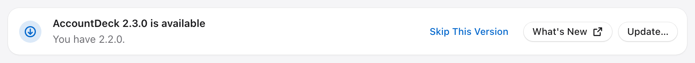

# Updating AccountDeck

An update replaces AccountDeck's code and keeps your data: every saved account, the settings and the
usage history. This page says how you learn of a new version, how an update runs, what it keeps, the
safety copy it makes first, and what to do in the rare case one goes wrong.

## Contents

- [How to update](#how-to-update)
  - [The update prompt](#the-update-prompt)
  - [By hand](#by-hand)
- [What an update does, step by step](#what-an-update-does-step-by-step)
- [What is kept and what is replaced](#what-is-kept-and-what-is-replaced)
- [The sign-in snapshot (`update-backups/`)](#the-sign-in-snapshot-update-backups)
- [Rollback](#rollback)
- [Installing an older version](#installing-an-older-version)
- [Is there a newer version?](#is-there-a-newer-version)
- [For contributors](#for-contributors)

## How to update

### The update prompt

Every 5 minutes, and when you open its menu or its dashboard, an installed AccountDeck asks GitHub whether a
newer release is out ([what it sends](#is-there-a-newer-version)), so it hears of one within minutes. When one
is, the dashboard shows it above your accounts:



- **Update…** first says what will happen: AccountDeck downloads the release from GitHub, checks its
  SHA-256 and installs it in a Terminal window; every saved account is kept and only AccountDeck restarts,
  so open Claude, Codex and `agy` sessions are not touched; if the new version does not start, the
  installer puts the one you have back. Choose **Update** and a Terminal window opens. It runs the
  installed `get.sh --version X`, which shows the steps [below](#what-an-update-does-step-by-step) as they
  happen. AccountDeck stops while the new version goes in, so its dashboard window closes (a browser tab
  loses its connection); when AccountDeck is back in the menu bar, choose **Open Dashboard**.
- **What's New** opens the release's page on GitHub in your browser.
- **Skip This Version** hides the prompt for that version. A later version is offered again, and
  **Check Now** in **Settings → About** offers the skipped one again.

The menu bar menu offers the same as **Update to X…**, whose confirmation also has **What's New** and
**Skip This Version**, and one macOS notification says that the version is out (it waits for the end of
quiet hours; none comes while notifications are off). While another action, such as a switch, or a
sign-in is in progress, **Update…** is disabled and the banner says why: finish or cancel it first. While
an update started from AccountDeck is running, **Update…** is disabled too, with "An update is already
running in a Terminal window."

**Settings → About** shows what the last check found, with **Check for updates automatically** (on unless
you turn it off; off, AccountDeck never asks GitHub) and **Check Now**. Only an installed copy asks, also one
installed from a git checkout; `run.py` started straight from a checkout, the demo and safe mode never
do. AccountDeck 2.0 and 2.1 have no update prompt;
update them once by hand, and from 2.2.0 on the prompt offers each new release.

### By hand

Run the command you installed with again, or the updater the install put in place (it is what
**Update…** runs):

```sh
bash "$HOME/Library/Application Support/AccountDeck2/app/get.sh"
```

Any of the three ways to install works as an update, also over an older AccountDeck 2 (2.0 or 2.1):
the one-line installer, a newer release package's `install.sh`, or `install.sh` from a newer git checkout.
They all end in the same `install.sh`. Run it as yourself, without `sudo`. AccountDeck may be running:
the installer stops it, updates it and starts it again. Your Claude Code, Claude Desktop, Codex and `agy`
sessions are not touched; only AccountDeck's own service restarts.

`--dry-run` prints what an update would do and changes nothing:

```sh
bash "$HOME/Library/Application Support/AccountDeck2/app/get.sh" --dry-run
```

## What an update does, step by step

`get.sh` first downloads the release package and its `.sha256` from GitHub, checks the SHA-256, checks
that the archive holds only an `AccountDeck2-mac/` folder (no absolute path, no `..`), unpacks it into a
temporary folder and runs its `install.sh` with the options you gave. The temporary folder is removed
afterwards. Then `install.sh`:

1. **Checks the Mac.** macOS 14 or newer on Apple silicon, run as yourself. Otherwise it stops with
   nothing changed.
2. **Refuses a downgrade.** When the installed version is newer than the package, it stops with nothing
   changed and names `--allow-downgrade` (see [below](#installing-an-older-version)).
3. **Says what it is doing:** "Updating AccountDeck 2 from OLD to NEW".
4. **Prepares the new code aside** and compares it with the installed code. Unchanged code is left
   alone.
5. **Keeps the Python runtime** when its pins are the same and it passes a self-test (an AES-GCM round
   trip). Otherwise it downloads Python, cffi and cryptography again, each checked against its pinned
   SHA-256.
6. **Waits for no switch.** If AccountDeck is in the middle of switching an account, the update refuses
   and changes nothing: let the switch finish and run it again.
7. **Tests the new code.** From a git checkout it runs the test suite against the new code; a release
   package carries no tests, so its code must at least import. A failure changes nothing.
8. **Counts your saved accounts**: the account rows per app (Claude Code, Claude Desktop, Codex, and
   Antigravity from its own table) and each account's saved sign-in record in the vault
   (`vault/<account id>.dpapi`, for Antigravity `vault/agy-<account id>.dpapi`), for example "Counted
   before the update: 8 saved accounts (2 Claude Desktop, 3 Claude Code, 1 Codex, 2 Antigravity, with 8
   saved sign-ins). They are counted again after it." Antigravity is named only when it has accounts.
   Temporary records (recovery copies, older generations of a sign-in) are not counted: a healthy service
   removes those by itself. Nor are Antigravity's records of a switch or an Add under way. Counts and file
   names only; it never reads a secret.
9. **Takes the sign-in snapshot** in `update-backups/` (see [below](#the-sign-in-snapshot-update-backups)):
   the database first, then, once AccountDeck has stopped through its own service, the vault.
10. **Swaps in the new version.** The previous app code goes to `app-backups/` (the last 5 are kept) and
    the app bundle is rebuilt when it differs.
11. **Starts the new version and checks it** for up to 60 seconds: it must answer on `/_health` as the
    new version and build, its background loop must be moving and nothing may be stalled.
12. **Counts again.** Every account row and every saved sign-in record counted before must still be
    there. Then it says "All N saved accounts are still here" and the update is done.

If step 11 or step 12 fails, the update counts as failed and the previous version goes back
([Rollback](#rollback)).

Only one install or update runs at a time. One started while another is running stops at once and says
"another install or update of AccountDeck 2 is running. Let it finish, then run install.sh again. Nothing
was changed."

## What is kept and what is replaced

Everything lives in `~/Library/Application Support/AccountDeck2`:

| Kept: your data | Replaced: the program |
|---|---|
| `vault/`: every saved sign-in, encrypted | `app/`: AccountDeck's code |
| `accounts.sqlite3`: accounts, settings, usage history | `runtime/`: Python and its two packages, only when the pins change |
| `backups/`: the daily database backups | `~/Applications/AccountDeck 2.app`, when it differs |
| `logs/`, `update-backups/` | |
| the vault key in your login keychain (`AccountDeck2 vault`) | |
| the Open at login LaunchAgent, if you turned it on | |

An update never writes to `vault/`, the database or the Keychain. Your accounts are found again because
the app's name, bundle id, folders, Keychain item and database format are the same in every version
([For contributors](#for-contributors)).

### Antigravity's table

AccountDeck keeps Antigravity accounts in a table of their own in `accounts.sqlite3`. When the new version
first opens a database without that table, from 2.0 or 2.1, it first tries to back the database up into
`backups/` (when it holds any data) and then adds the empty table. A backup that cannot be made is
logged as a warning and the table is added all the same. The database stays at schema 2 and nothing else
in it changes. The installer's count of saved accounts includes Antigravity's, so an update that loses one
rolls back like any other.

AccountDeck 2.0 and 2.1 don't know Antigravity. If one of them runs on this data again, after a rollback
for example, it opens it as before, doesn't show the Antigravity accounts and leaves them and their saved
sign-ins alone; the next update finds them again.

## The sign-in snapshot (`update-backups/`)

Before an update replaces a version that was already installed, the installer copies your saved sign-ins
into `~/Library/Application Support/AccountDeck2/update-backups/<date>-<time>-v<old version>/`:

- `vault/`: a copy of the vault, taken while AccountDeck is stopped and compared with the original;
- `accounts.sqlite3.gz`: a consistent copy of the database, made through SQLite's backup interface;
- `MANIFEST.txt`: the versions, the time, the number of account rows (Claude Code, Claude Desktop and
  Codex; Antigravity's table is in the copy too) and vault files. Nothing secret.

The folder is readable only by you, and the records stay encrypted under the same Keychain key. The last
3 snapshots are kept. `uninstall.sh` keeps them with your data; `uninstall.sh --delete-data` deletes
them.

The snapshot is a last resort, and AccountDeck never puts it back by itself. Use it only when an update
lost accounts and its rollback did not bring them back. **A sign-in renewed after the snapshot is stale
in it:** Claude Code and Codex renew their logins as they work, and an old refresh token may already be
spent. Accounts restored from a snapshot can therefore ask you to **Sign In Again**; anything added,
renamed or read since the snapshot is lost.

To put a snapshot back by hand:

1. Choose **Quit AccountDeck 2** in its menu bar menu.
2. In Terminal, move the current data aside and copy the snapshot in (replace `FOLDER` with the snapshot's
   folder name):

   ```sh
   cd "$HOME/Library/Application Support/AccountDeck2"
   mkdir -m 700 before-restore
   mv vault accounts.sqlite3* before-restore/
   cp -Rp "update-backups/FOLDER/vault" vault
   gunzip -c "update-backups/FOLDER/accounts.sqlite3.gz" > accounts.sqlite3
   chmod 600 accounts.sqlite3
   ```

3. Open AccountDeck 2 and sign in again to any account that asks.

It works only for the same macOS user and the same data folder: the vault key in the Keychain is filed
under that folder's path.

## Rollback

When the new version does not come up healthy within 60 seconds, or an account or its saved sign-in
record is missing after the update, the installer puts the previous app, app bundle and runtime back, starts the
previous version, checks that it answers, says what failed and exits with status 1. When the health
check failed, the message names the logs to look at. When accounts were missing, it names the snapshot
folder instead (or, when this run took no snapshot, the daily database backups). A rollback never writes
to the vault, the database or the Keychain.

The previous app code also stays in `~/Library/Application Support/AccountDeck2/app-backups/` (the last
5 updates). `uninstall.sh` removes that folder, since it holds only old code.

If an update rolls back, AccountDeck keeps running the version you had. Please
[open an issue](https://github.com/boha-k/accountdeck/issues) with the installer's output and the output
of `run.py --doctor` ([TROUBLESHOOTING.md](TROUBLESHOOTING.md#the-health-report)). The installer's output
contains no secrets, but its paths show your macOS user name and home folder, and issues are public: replace
them (for example with `/Users/NAME`) before you paste it.

## Installing an older version

`get.sh --version X.Y.Z` installs a given release instead of the latest. When that is older than what is
installed, add `--allow-downgrade`. For example, to go back to 2.2.0 from a later version:

```sh
bash "$HOME/Library/Application Support/AccountDeck2/app/get.sh" --version 2.2.0 --allow-downgrade
```

Only published releases can be installed this way; the first is 2.2.0. Data saved by a newer version may
not open in an older one: AccountDeck refuses a database with a newer schema and never downgrades it.
Antigravity's table is inside the same schema, so an older version that predates it still opens the data
and leaves the Antigravity accounts alone ([Antigravity's table](#antigravitys-table)).

## Is there a newer version?

An installed AccountDeck asks by itself and shows [the update prompt](#the-update-prompt) when there is.
The first check runs 30 seconds after AccountDeck starts, then one every 5 minutes. Opening the menu bar menu
or the dashboard also checks, when the last check is more than a minute old; that check runs in the
background, so the menu and the page never wait for it. A check that fell due while the Mac slept runs
within a minute of the wake.
After a check that could not tell, the next one waits longer each time: 5, 10, 20 and 40 minutes, then an
hour. When GitHub asks AccountDeck to wait (a `Retry-After` on a refusal), it waits that long, up to 6 hours.

Each check is one HEAD request to `https://github.com/boha-k/accountdeck/releases/latest`: it asks only for
the headers, has no body in either direction, follows no redirect and carries the user agent
`AccountDeck2/<version> (+local)` and nothing else about you or your Mac: no account, no identifier, no
cookie. GitHub answers with a redirect to the latest release's page, and only the version number in that
address is kept, after checking that the address is exactly this repository's release page with a plain
version. If GitHub ever answers in a way AccountDeck cannot read, AccountDeck asks
`https://api.github.com/repos/boha-k/accountdeck/releases/latest` instead, at most once a day, with the same
user agent and nothing more; of that answer too only the version number of a published release is kept. No
text from GitHub is shown. With **Check for updates automatically** off in **Settings → About**, no request
is made.

To ask from Terminal:

```sh
bash "$HOME/Library/Application Support/AccountDeck2/app/get.sh" --check
```

It prints the installed and the latest version and exits 0 when you are up to date, 10 when a newer
release exists (or none is installed) and 1 when it could not tell. It only asks github.com where its
latest-release page points and changes nothing. You can also watch the repository's releases on GitHub.

## For contributors

### The data-compatibility promise

An existing user's accounts are found again only because these values have not changed since the first
build. None of them may change without a migration, a test that proves it and the maintainer's
agreement.

| What | Value |
|---|---|
| App name, executable | `AccountDeck 2`, `AccountDeck2` |
| Bundle id and LaunchAgent label | `local.accountdeck2` |
| Support folder (data, `app/`, `runtime/`, `app-backups/`) | `~/Library/Application Support/AccountDeck2` |
| App bundle | `~/Applications/AccountDeck 2.app` |
| Vault key in the login keychain | service `AccountDeck2 vault`, account = first 16 hex digits of sha256(resolved data folder path) |
| Vault records | `vault/*.dpapi`: `ADK1` + nonce + AES-256-GCM (the extension is a leftover name; it stays) |
| Database | `accounts.sqlite3`, schema 2 (`PRAGMA user_version`); a newer schema is refused, never downgraded |
| Service | port 53157, `runtime.json`, `/_health`, `/api/session`, `/api/state`, `/api/stop` as `install.sh` uses them (it must keep talking to 2.0.0 and 2.1.0) |
| Owner lock | `~/Library/Application Support/AccountDeck2-Owner.lock` |

Antigravity's data has names of its own, frozen in the same way from 2.2.0: the table
`antigravity_accounts`, the vault records `agy-<32 hex>`, `agy-transaction-<32 hex>` and `agy-enrollment`,
and the settings `agy_usage_on_open` and `agy_notice_seen`. They are kept apart from the other apps' data
because an older build stops reading every account when it meets an account of an app it does not know.
[CONTRIBUTING.md](../CONTRIBUTING.md#data-compatibility) has the full table.

The Keychain is reached through `/usr/bin/security`, so replacing or re-signing the Python runtime never
changes who may read the vault key.

### The tests that hold it

- **`tests/test_data_compat.py`**: one committed data folder per released version
  (`tests/fixtures/baseline-data.zip` for 2.0.0, `tests/fixtures/baseline-data-2.1.0.zip` for 2.1.0).
  This build must load every account, secret, setting and import record from each, and leave the schema
  unchanged but for Antigravity's table, added after a backup. The reverse check, that the old build
  still opens the folder after this build used it and wrote every kind of Antigravity data into it (what
  a rollback needs), runs against old checkouts named in `ACCOUNTDECK_BASELINES` (folders,
  `:`-separated); each old build must read its own data as before, list no Antigravity account, tick once
  and find nothing to recover, and this build must then find its Antigravity data unchanged.
  `tools/check.sh` makes the old builds from the tags `v2.0.0` and `v2.1.0` with `git archive` when the
  tags exist, and says which old builds it checked or that it skipped them. Both releases predate this
  repository's history, so only the maintainer's checkout has their tags.
- **`tests/test_frozen_identifiers.py`**: the values above and Antigravity's names, spelled out, with a
  message that says what changing one costs.
- **`tools/upgrade_test.sh`**: a hermetic update test. For each old version it installs the old build
  under `--prefix`, puts that version's data fixture in the data folder, hashes every data file, installs
  this build over it and requires: the data files unchanged byte for byte, the new version in `app/`,
  the old one in `app-backups/`, a snapshot in `update-backups/` equal to the vault, and the installed
  code reading every account and secret. With a stub service it also checks that a healthy update reports
  the census (Antigravity accounts included), an unhealthy one rolls back with the data untouched, an
  update that loses an Antigravity account or its saved sign-in rolls back, a busy service is refused and
  a downgrade is refused.
- **`tools/mac_package_test.sh`**: the built package installs into an empty folder, carries only the
  files it should, and `get.sh` installs it from a local release folder.

CI runs all of them on every pull request and on pushes to `main` (`.github/workflows/check.yml`), and
again before a tagged release is published (`.github/workflows/release.yml`).
